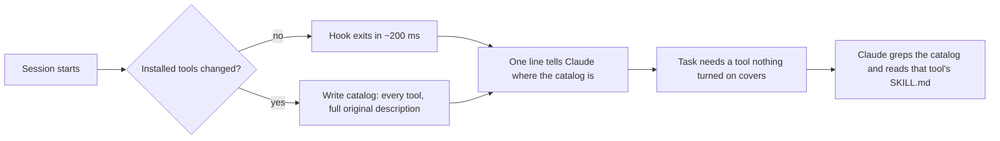

# Stockroom

[](https://github.com/Buirst/stockroom/actions/workflows/test.yml)
[](LICENSE)

Install as many skills, plugins and MCP servers as you want. Claude keeps knowing what each one is for, without loading
them all into every session.

Claude Code puts a short description of every installed skill into each session, inside a fixed budget. Once you pass
that budget, it drops descriptions, and Claude stops picking those skills. MCP servers, hooks and plugins also cost
context every time. So the usual advice is to install less.

Stockroom keeps a catalog of everything you have installed, with each tool's original description in full, in plain
files outside the context. At the start of each session it tells Claude, in one line, where the catalog is. Claude
searches it when a task needs something that nothing turned on covers. That lets you turn off what you rarely use and
still have Claude find it.

## Install

```sh
claude plugin marketplace add Buirst/stockroom
claude plugin install stockroom@stockroom
```

Requires Node.js 18 or newer. Tested by hand on Windows 11; the test suite runs on Windows, macOS and Linux in CI.
Want to help test it? See [docs/TESTING.md](docs/TESTING.md).

## How it works



## What happens with no configuration

At the start of the next session, a hook writes the catalog to `~/.claude/stockroom/catalog/` and gives Claude this
line:

> Stockroom: every installed tool, even off ones, is described in `<catalog folder>`. Before planning or building, grep
> skills.md there; read the SKILL.md of a tool that covers it, before building from scratch. Not for plain questions.

Stockroom turns nothing off. The catalog is rewritten only when what you have installed changes. When nothing changed, the
hook compares a fingerprint and exits.

The catalog has one file per kind of tool (`skills.md`, `commands.md`, `agents.md`, `mcp.md`, `hooks.md`,
`plugins.md`) and a `README.md` telling Claude how to use it. Each entry looks like this:

```
### video:cut
- kind: skill · origin: plugin · plugin: video · status: off (turn on: enabledPlugins["video@mk"] = true)
- path: /p/video/skills/cut/SKILL.md · skill folder: /p/video/skills/cut · plugin root: /p/video
Cut a video
```

The description under each entry is copied as it is from the tool's own files. Stockroom never summarizes or shortens
it.

A skill that is off can still be used: Claude reads its `SKILL.md` from the path in the catalog and follows it. An MCP
server, subagent or hook that is off cannot run in the current session, so Claude tells you what to turn on and that
Claude Code needs a restart.

## The panel

Type `/stockroom` in Claude Code. It shows what is installed and offers the actions below. Claude never opens the
panel on its own, and it changes your settings only after you say yes to a plan it has shown you.

You can also run each action from the command line, inside the plugin folder:

| Command | What it does |
|---|---|
| `node bin/stockroom.js status` | Tools found by kind, on and off; catalog location and age; size of the skill listing |
| `node bin/stockroom.js check [--all]` | Names in your map that match no installed tool, and tools your map never mentions |
| `node bin/stockroom.js catalog [--read-mcp]` | Rewrites the catalog now; `--read-mcp` also asks your MCP servers for their tool descriptions |
| `node bin/stockroom.js shelf plan` | Shows what the shelf would turn off, and what it turned off earlier that you used anyway (from the catalog) and would turn back on; changes nothing |
| `node bin/stockroom.js shelf apply` | Applies the last plan, after backing up `settings.json` |
| `node bin/stockroom.js undo` | Reverts what Stockroom changed in `settings.json` |
| `node bin/stockroom.js map init [--out <dir>]` | Writes a starter map; never overwrites one |
| `node bin/stockroom.js map draft-data [--group <name>]` | What Claude drafts a map section from: full descriptions, source, last use, current rows |
| `node bin/stockroom.js map index [--out <file>]` | A short index of your map (about 4 KB) for a rule file that loads every session; the full map stays in the catalog |
| `node bin/stockroom.js usage [--days N]` | Tools used in your sessions over the last N days |

## Your map (optional)

If several of your tools do the same job, a map says which one Claude should prefer. Most people do not need one. With a
map, the catalog adds `by-function.md`, a short index with one line per job and its first tool, which Claude checks
first; every alternative, in order, is in one file per section under `by-function/`, so Claude reads only the section
of the job at hand.

A map is any Markdown file with tables that have a `Tool` column. Each row is a job; the tools in backticks are listed
in order of preference.

```markdown
## Browser

| Case | Tool | Why |
|---|---|---|
| Read a page that needs JavaScript | MCP `playwright`, then `chrome-devtools` | Returns data, not the whole DOM |
| Watch a video | `/watch` | Transcript and frames without downloading by hand |
```

`MCP` before a name means the MCP server of that name; `/name` means a skill or command. Patterns such as `gsap-*` are
allowed.

Tools outside Claude Code belong in the map too: write `web`, `app` or `CLI` before the name (``web `example.com` ``,
``app `Excel` ``, ``CLI `ffmpeg` ``); a full `https://` address counts as a website on its own. They go to
`external.md` in the catalog, with the rows that name them. `check` and `catalog` also say whether each CLI is on your
`PATH`; the session-start hook does not check that, to stay fast. Run `map init` to get a starter file with one row per installed tool, then add its path to `mapFiles`.

## Configuration

Everything is optional. Put the keys you need in `~/.claude/stockroom/config.json`. If you set `CLAUDE_CONFIG_DIR`,
every `~/.claude` path here lives under that folder instead, as in Claude Code.

```json
{
  "shelf": "usage",
  "days": 30,
  "neverOff": ["my-daily-skill", "some-plugin"],
  "mapFiles": ["~/notes/tool-map.md"]
}
```

| Key | Values | Default |
|---|---|---|
| `shelf` | `null` (turn nothing off), `"map"` (in each case of your map keep the first `keep` tools, plus any used in `days`), `"usage"` (turn off what was not used in `days`), `"list"` (turn off what `list` names), `"none"` (turn off everything except `neverOff`) | `null` |
| `days` | Days of use that keep a tool on with `"usage"` and `"map"` | `30` |
| `keep` | With `"map"`: how many tools stay on in each case | `1` |
| `unmapped` | With `"map"`: tools no case names: `"keep"`, `"usage"` (off if unused in `days`) or `"off"` | `"keep"` |
| `sections` | With `"map"`: rules per map heading (`*` allowed): `{ "Design": { "keep": 2, "days": 60, "order": ["impeccable"] } }`; `order` puts those tools first | `{}` |
| `alwaysOff` | Names or patterns turned off in every mode | `[]` |
| `list` | Names or patterns to turn off with `"list"` | `[]` |
| `neverOff` | Names or patterns that always stay on, even over `alwaysOff`; a plugin name keeps the whole plugin | `[]` |
| `mapFiles` | Map files; `*` is allowed in the file name | `[]` |
| `offAs` | How a personal or project skill goes to the stockroom: `"off"` (hidden) or `"name-only"` (its name stays in the listing, about 25 characters) | `"off"` |
| `readMcp` | `true` to ask MCP servers for their tools whenever the panel rebuilds the catalog | `false` |
| `catalogDir` | Where the catalog is written | `~/.claude/stockroom/catalog` |

## What can be turned off

Stockroom only writes official, reversible settings, and only in `~/.claude/settings.json`.

| Tool | Setting |
|---|---|
| Personal or project skill or command | `skillOverrides["name"] = "off"` |
| Plugin, with all its skills, commands, subagents, MCP servers and hooks | `enabledPlugins["plugin@marketplace"] = false` |
| MCP server from a project `.mcp.json` | `disabledMcpjsonServers` |
| MCP server in your user or local scope | `deniedMcpServers` |
| claude.ai connector (Linear, Gmail…) | `deniedMcpServers` by its display name, `"claude.ai Linear"` |

Some tools have no setting that turns off just that one, so they stay on and in the catalog. Account skills synced from
claude.ai can only be turned off all together. User and project subagents have no off switch. A single hook can only be
turned off by turning off every hook (`disableAllHooks`), which Stockroom never does. Stockroom never turns off its own plugin, and never touches a skill marked
`disable-model-invocation` (it is not in the listing, so turning it off saves nothing and only hides `/name`).

With `"usage"`, plugins that work through hooks or language servers stay on. They run without being called, so their
use cannot be measured, and turning them off would change every session without Claude ever noticing.

`undo` removes only the entries Stockroom wrote that still hold the value it wrote. If you turned a plugin back on by
hand, `undo` leaves it on. Every `shelf apply` first copies `settings.json` to `~/.claude/stockroom/backups/`.

## Privacy

Stockroom makes no network requests. It reads MCP tool descriptions only when you ask (`--read-mcp` or `readMcp`), and
then it only starts the local (stdio) servers you already configured and turned on, and from a project `.mcp.json` only
the ones you approved in Claude Code (a cloned repository's servers never start on their own), for up to 10 seconds each, to call `tools/list`.
Remote servers are not read in this version. Successful answers are cached in `~/.claude/stockroom/mcp-cache.json`.

Each catalog entry names where the tool comes from (its repository, package or address, and version) when your
installed files say so. Stockroom's code never downloads anything from there. When you draft a map with
`/stockroom map`, Claude asks you first before reading those official pages online. What it reads is saved in
`~/.claude/stockroom/sources/` and is read again only when the tool's version changes. Claude treats those pages as
information, never as instructions.

The catalog lives outside your working folder. If Claude asks permission each time it reads it, `status` prints the
`Read(...)` rule to add to `permissions.allow`.

## Measured numbers

On a setup with 602 tools (433 skills, 48 plugins, 27 MCP servers, 52 hooks, 20 subagents, 22 commands) on Windows 11:

| What | Result |
|---|---|
| Full catalog written | 73 ms; 0 of 602 descriptions missing or changed |
| Session start when nothing changed | about 200 ms (fingerprint 57 ms plus loading the code) |
| Largest catalog file | `skills.md`, 374 KB (Claude searches it; it does not read it whole) |

How often Claude finds and uses the right tool in real sessions: see [Real test](#real-test-2026-10-21).

## Uninstall

1. Run `undo` from the panel (or `node bin/stockroom.js undo`) to restore what Stockroom turned off.
2. `claude plugin uninstall stockroom@stockroom`
3. Delete `~/.claude/stockroom/` if you no longer want the catalog, backups and cache.

## License

MIT

## Real test (2026-10-21)

On the author's setup (577 tools, listing 93,098 characters against Claude Code's 30,000 default, so descriptions
truncated), `claude -p` sessions in plan mode, at most 6 turns, graded with `e2e-grade`:

| Run | Cases | Traps (no tool needed) |
|---|---|---|
| Turned-off tools, first hook line | 3/10 used the right tool | 4/4 untouched |
| Turned-off tools, current hook line (misses rerun) | 6/10 (7/10 counting a SKILL.md read through a loop variable) | 4/4 |
| Turned-on tools, truncated listing | 8/10 | — |
| Same, with the map wired and the 64 KB tool guide cut to 13 KB of rules | 8/10 (+ the map used on turned-off tools) | 4/4 |
