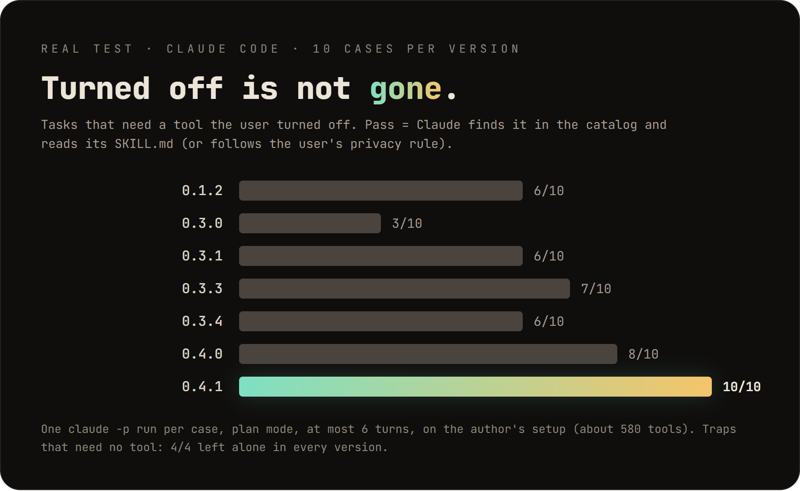
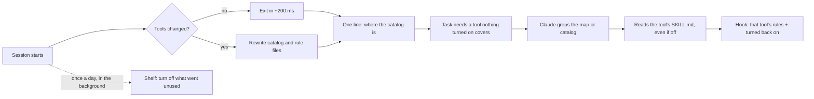
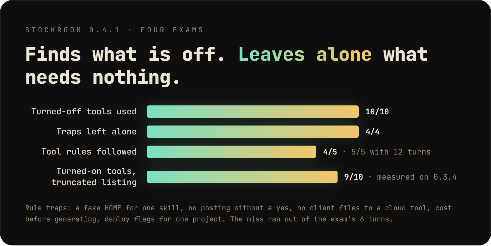
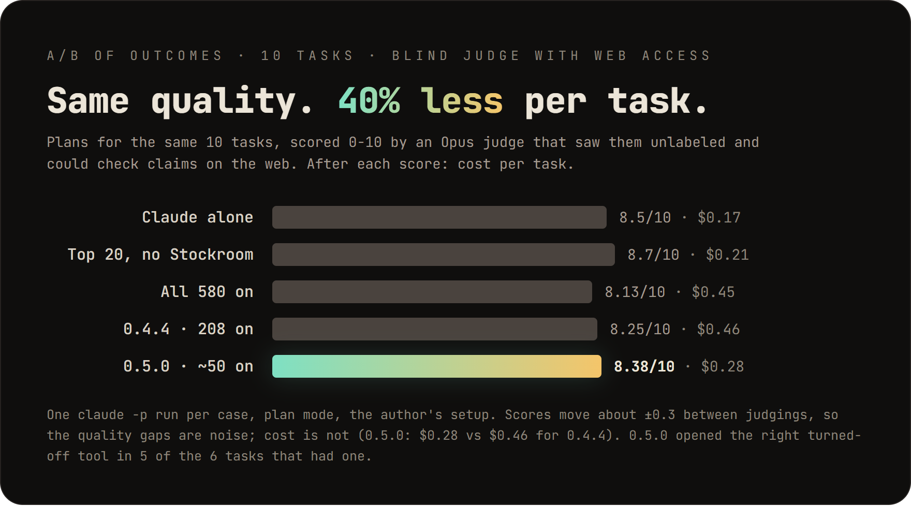
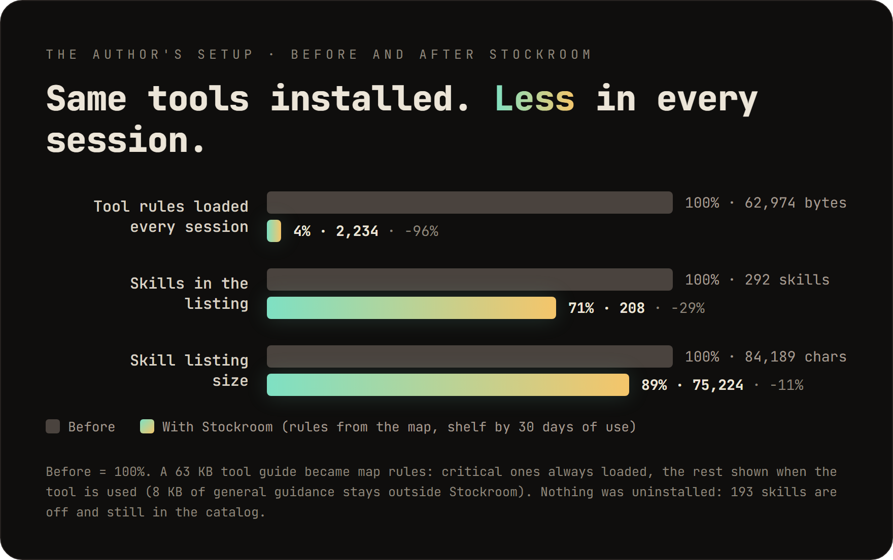
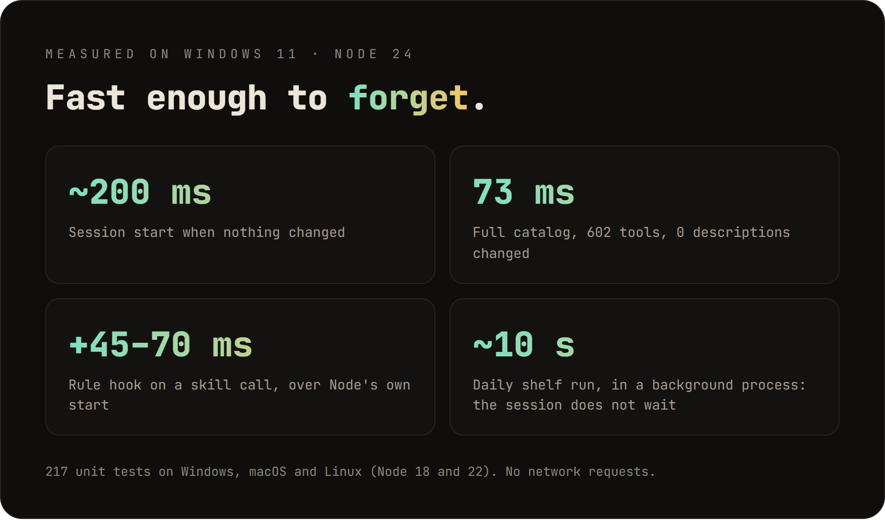

<h1 align="center">
  <picture>
    <source media="(prefers-color-scheme: dark)" srcset="docs/brand/lockup-dark.svg">
    
  </picture>
</h1>

[](https://github.com/Buirst/stockroom/actions/workflows/test.yml)
[](LICENSE)

Install as many skills, plugins and MCP servers as you want. Claude keeps knowing what each one is for, without loading
them all into every session.

Claude Code puts a short description of every installed skill into each session, inside a fixed budget. Past that
budget it drops descriptions, and Claude stops picking those skills. MCP servers, hooks and long rule files also cost
context every time. So the usual advice is to install less.

Stockroom keeps a catalog of everything you have installed, with each tool's original description in full, in plain
files outside the context. Claude searches it when a task needs something that nothing turned on covers, and reads the
tool's `SKILL.md` even when it is off. That lets you turn off what you rarely use, and Stockroom can do that for you:
off after weeks without use, back on the moment Claude needs it.


<sub>Sample setup with invented tools; every line of Stockroom output is real, home folder shown as `~`.</sub>

<p align="center"></p>

Measured in real Claude Code sessions, not simulated: method, every case and every version in
[docs/BENCHMARKS.md](docs/BENCHMARKS.md).

## Install

```sh
claude plugin marketplace add Buirst/stockroom
claude plugin install stockroom@stockroom
```

Requires Node.js 18 or newer. No dependencies, no network requests. Tested by hand on Windows 11; the test suite runs on
Windows, macOS and Linux in CI. Want to help test it? See [docs/TESTING.md](docs/TESTING.md).

## Features

| Feature | What it does | Needs |
|---|---|---|
| **Catalog** | Every installed skill, command, subagent, plugin, MCP server and hook, with its full original description, in files Claude can grep | Nothing |
| **Session line** | One line at session start telling Claude where the catalog is; rewritten only when your tools change (about 200 ms otherwise) | Nothing |
| **Map** | Your own "for this job, prefer this tool" tables. Claude checks a short index (`by-function.md`) first; off tools carry the path of their `SKILL.md` | A map file |
| **Tool rules** | Rules per tool from the map: critical ones always loaded (about 2 KB), the rest shown only when the tool is used, project ones only in that project | A map with a `Rule` table |
| **Reminder** | Once per session, if Claude writes a plan or searches without checking the map, it is reminded to grep it and read the tool's `SKILL.md` | A map |
| **Prompt line** | One line next to each prompt: grep the map for the job, in your own words, before exploring files | A map |
| **Shelf** | Turns off what you do not use, by usage, by your map or by a list, through official reversible settings, with a backup | `"shelf"` in config |
| **Automatic shelf** | Off after `days` without use (or, with `keepTop`, everything but your N most-used tools), once a day in the background; back on as soon as Claude reads the tool's `SKILL.md` | `"auto": true` |
| **Panel** | `/stockroom`: status, map checks, shelf and rule plans, undo; changes nothing without your yes | Nothing |
| **Report and doctor** | Whether the map is used and followed; a health check of hooks, rules and project paths | Nothing |

## How it works



## What happens with no configuration

At the start of the next session, a hook writes the catalog to `~/.claude/stockroom/catalog/` and gives Claude this
line:

> Stockroom: every installed tool, even off ones, is described in `<catalog folder>`. Before planning or building, grep
> skills.md there; read the SKILL.md of a tool that covers it, before building from scratch. Not for plain questions.

Stockroom turns nothing off. The catalog is rewritten only when what you have installed changes. When nothing changed, the
hook compares a fingerprint and exits.

The catalog has one file per kind of tool (`skills.md`, `commands.md`, `agents.md`, `mcp.md`, `hooks.md`,
`plugins.md`) and a `README.md` telling Claude how to use it. Each entry looks like this:

```
### video:cut
- kind: skill · origin: plugin · plugin: video · status: off (turn on: enabledPlugins["video@mk"] = true)
- path: /p/video/skills/cut/SKILL.md · skill folder: /p/video/skills/cut · plugin root: /p/video
Cut a video
```

The description under each entry is copied as it is from the tool's own files. Stockroom never summarizes or shortens
it.

A skill that is off can still be used: Claude reads its `SKILL.md` from the path in the catalog and follows it. An MCP
server, subagent or hook that is off cannot run in the current session, so Claude tells you what to turn on and that
Claude Code needs a restart.

## The panel

Type `/stockroom` in Claude Code. It shows what is installed and offers the actions below. Claude never opens the
panel on its own, and it changes your settings only after you say yes to a plan it has shown you.

You can also run each action from the command line, inside the plugin folder:

| Command | What it does |
|---|---|
| `node bin/stockroom.js status` | Tools found by kind, on and off; catalog location and age; size of the skill listing |
| `node bin/stockroom.js check [--all]` | Names in your map that match no installed tool, and tools your map never mentions |
| `node bin/stockroom.js catalog [--read-mcp]` | Rewrites the catalog now; `--read-mcp` also asks your MCP servers for their tool descriptions |
| `node bin/stockroom.js shelf plan` | Shows what the shelf would turn off, and what it turned off earlier that you used anyway (from the catalog) and would turn back on; changes nothing |
| `node bin/stockroom.js shelf apply` | Applies the last plan, after backing up `settings.json` |
| `node bin/stockroom.js rules plan` | Shows the rule files Stockroom would write from your map, with their size, and any warnings; changes nothing |
| `node bin/stockroom.js rules apply` | Writes them, after a `rules plan` of the same map; backs up what it replaces |
| `node bin/stockroom.js auto` | What the session hook runs once a day with `"auto": true`: plans the shelf and applies it at once, logging to `auto.log` |
| `node bin/stockroom.js undo` | Reverts what Stockroom changed in `settings.json` and removes the rule files it wrote |
| `node bin/stockroom.js report [--days N] [--json]` | Whether the map is used: map reads followed by a tool they named, rows consulted and followed, rules shown on use, bytes loaded every session |
| `node bin/stockroom.js doctor` | Health check: hooks registered, generated rules in step with the map, project paths that find files; exits 1 on a problem |
| `node bin/stockroom.js map init [--out <dir>]` | Writes a starter map; never overwrites one |
| `node bin/stockroom.js map draft-data [--group <name>]` | What Claude drafts a map section from: full descriptions, source, last use, current rows |
| `node bin/stockroom.js map index [--out <file>]` | A short index of your map (about 4 KB) for a rule file that loads every session; the full map stays in the catalog |
| `node bin/stockroom.js usage [--days N]` | Tools used in your sessions over the last N days |

## Your map (optional)

If several of your tools do the same job, a map says which one Claude should prefer. Most people do not need one. With a
map, the catalog adds `by-function.md`, a short index with one line per job and its first tool, which Claude checks
first; every alternative, in order, is in one file per section under `by-function/`, so Claude reads only the section
of the job at hand.

A map is any Markdown file with tables that have a `Tool` column. Each row is a job; the tools in backticks are listed
in order of preference.

```markdown
## Browser

| Case | Tool | Why |
|---|---|---|
| Read a page that needs JavaScript | MCP `playwright`, then `chrome-devtools` | Returns data, not the whole DOM |
| Watch a video | `/watch` | Transcript and frames without downloading by hand |
```

`MCP` before a name means the MCP server of that name; `/name` means a skill or command. Patterns such as `gsap-*` are
allowed.

Tools outside Claude Code belong in the map too: write `web`, `app` or `CLI` before the name (``web `example.com` ``,
``app `Excel` ``, ``CLI `ffmpeg` ``); a full `https://` address counts as a website on its own. They go to
`external.md` in the catalog, with the rows that name them. `check` and `catalog` also say whether each CLI is on your
`PATH`; the session-start hook does not check that, to stay fast. Run `map init` to get a starter file with one row per installed tool, then add its path to `mapFiles`.

## Tool rules and projects (optional)

Some tools come with rules: one costs credits, another uploads files to its cloud, a third needs a fake `HOME`. If
those rules live in a file Claude Code always loads, they cost context in every message, even in sessions that never
touch those tools. The map can hold them instead, in tables with a `Rule` column:

```markdown
| Tool | Rule | Level | Project |
|---|---|---|---|
| `cloud-editor` | Uploads files to its cloud: never client documents | critical | |
| `music-stats` | One credit per call: say so before a batch | on use | |
| `design-review` | Run a second opinion before showing a design | critical | Acme |
```

- **critical** rules go to `~/.claude/rules/stockroom-critical.md`, which Claude Code loads in every session (budget:
  4 KB). Use it for money, privacy, accounts, production and actions that reach other people.
- **on use** rules (the default) are shown to Claude when it uses that skill, by a `PreToolUse` hook on the `Skill`
  tool and on reads of a `SKILL.md`. They cost nothing until then. The hook adds about 45 to 70 ms to Node's own
  start-up, and only on those calls.
- **Project** rows and rules go to `~/.claude/rules/stockroom-<project>.md` with a `paths:` header, which Claude Code
  loads when Claude reads or edits a file of that project. Name projects in `config.json` (`"projects"`), with paths
  relative to the folder where you start your sessions. A section can also say `Project: <name>` under its heading.
- MCP calls and shell commands are not hooked (they are frequent, and every hook run starts Node), so their rules
  must be critical or belong to a project; `check` warns otherwise.
- A tool named by a critical rule is never turned off by the shelf.

With a map, one more hook reminds Claude once per session, if it has not looked at the map yet, when it writes a plan,
leaves plan mode or searches the web or the tool list (where the real test showed it missing turned-off tools). The
reminder asks it to grep the map and read the `SKILL.md` of the tool it names, so the plan is built on the tool and
not just on its name:

> Stockroom: this session has not checked the tool map yet. Before you finish, grep `<catalog>/by-function.md` for this
> job and read the SKILL.md of the tool it names, even one marked "off: read <path>" (it works now through that file);
> build the plan on it, not just its name.

Run `rules plan` to see what would be written, then `rules apply`. Afterwards the session-start hook keeps the files
in step with the map. If an edit would leave fewer critical rules than before, the hook keeps the previous files and
tells Claude so in its line. Stockroom never overwrites or deletes a file it did not write (its files start with a
`generated by Stockroom` marker), and `undo` removes them.

## Configuration

Everything is optional. Put the keys you need in `~/.claude/stockroom/config.json`. If you set `CLAUDE_CONFIG_DIR`,
every `~/.claude` path here lives under that folder instead, as in Claude Code.

```json
{
  "shelf": "usage",
  "days": 30,
  "neverOff": ["my-daily-skill", "some-plugin"],
  "mapFiles": ["~/notes/tool-map.md"]
}
```

| Key | Values | Default |
|---|---|---|
| `shelf` | `null` (turn nothing off), `"map"` (in each case of your map keep the first `keep` tools, plus any used in `days`), `"usage"` (turn off what was not used in `days`), `"list"` (turn off what `list` names), `"none"` (turn off everything except `neverOff`) | `null` |
| `days` | Days of use that keep a tool on with `"usage"` and `"map"` | `30` |
| `keepTop` | With `"usage"`: only the N most-used tools in `days` stay on (a plugin counts the uses of all its tools); the rest go off and stay findable. A new install gets 7 days | `null` |
| `keep` | With `"map"`: how many tools stay on in each case | `1` |
| `unmapped` | With `"map"`: tools no case names: `"keep"`, `"usage"` (off if unused in `days`) or `"off"` | `"keep"` |
| `sections` | With `"map"`: rules per map heading (`*` allowed): `{ "Design": { "keep": 2, "days": 60, "order": ["impeccable"] } }`; `order` puts those tools first | `{}` |
| `alwaysOff` | Names or patterns turned off in every mode | `[]` |
| `list` | Names or patterns to turn off with `"list"` | `[]` |
| `neverOff` | Names or patterns that always stay on, even over `alwaysOff`; a plugin name keeps the whole plugin | `[]` |
| `mapFiles` | Map files; `*` is allowed in the file name | `[]` |
| `projects` | Project names and their paths, relative to where sessions start: `{ "Acme": ["acme/**"] }` | `{}` |
| `offAs` | How a personal or project skill goes to the stockroom: `"off"` (hidden) or `"name-only"` (its name stays in the listing, about 25 characters) | `"off"` |
| `readMcp` | `true` to ask MCP servers for their tools whenever the panel rebuilds the catalog | `false` |
| `catalogDir` | Where the catalog is written | `~/.claude/stockroom/catalog` |
| `auto` | `true` keeps the shelf up to date by itself (see below) | `false` |

## Automatic shelf

With `"auto": true` and a `shelf` mode, the shelf follows what you use:

- **Back on when used.** When Claude reads the SKILL.md of a skill or plugin that Stockroom turned off, it is turned
  back on at once (from the next session; the SKILL.md already works in this one), and Claude is told.
- **Off when unused.** Once a day, the session hook plans the shelf and applies it in a background process, so the
  session does not wait. The next session tells Claude what changed.

Every change is logged in `~/.claude/stockroom/auto.log`, and `undo` reverts it. MCP servers and connectors cannot be
used while they are off, so they only come back with `undo` or by hand. Tools you turned off yourself are never
turned on.

What Claude sees, word for word:

> Stockroom turned off for lack of use: pitch-deck, release-notes, sql-tuning, media@market; back on: nothing. They stay
> in the catalog and work through their SKILL.md; "stockroom undo" reverts.

> Stockroom: media@market was off for lack of use and is back on from the next session; this SKILL.md works now.

What the automatic shelf never turns off:

- anything in `neverOff` (a plugin name keeps the whole plugin), and Stockroom itself;
- a tool named by a critical rule in your map, and the plugin that holds it;
- plugins that work through hooks or language servers, since their use cannot be measured;
- account skills synced from claude.ai and subagents, which have no switch of their own.

Use counts come from your session transcripts (skills launched, subagents, MCP calls, `SKILL.md` reads) over `days`. `claude -p` runs (scripts, benchmarks) do not count.
Installing counts as a use: a plugin installed, or a personal skill added or edited, less than `days` ago stays on (a recent install never turns an off tool back on; that needs a real use).
The run starts from the folder of the session that triggers it, so it sees the project skills under that folder.

## What can be turned off

Stockroom only writes official, reversible settings, and only in `~/.claude/settings.json`.

| Tool | Setting |
|---|---|
| Personal or project skill or command | `skillOverrides["name"] = "off"` |
| Plugin, with all its skills, commands, subagents, MCP servers and hooks | `enabledPlugins["plugin@marketplace"] = false` |
| MCP server from a project `.mcp.json` | `disabledMcpjsonServers` |
| MCP server in your user or local scope | `deniedMcpServers` |
| claude.ai connector (Linear, Gmail…) | `deniedMcpServers` by its display name, `"claude.ai Linear"` |

Some tools have no setting that turns off just that one, so they stay on and in the catalog. Account skills synced from
claude.ai can only be turned off all together. User and project subagents have no off switch. A single hook can only be
turned off by turning off every hook (`disableAllHooks`), which Stockroom never does. Stockroom never turns off its own plugin, and never touches a skill marked
`disable-model-invocation` (it is not in the listing, so turning it off saves nothing and only hides `/name`).

With `"usage"`, plugins that work through hooks or language servers stay on. They run without being called, so their
use cannot be measured, and turning them off would change every session without Claude ever noticing.

`undo` removes only the entries Stockroom wrote that still hold the value it wrote. If you turned a plugin back on by
hand, `undo` leaves it on. Every `shelf apply` first copies `settings.json` to `~/.claude/stockroom/backups/`.

## Privacy

Stockroom makes no network requests. It reads MCP tool descriptions only when you ask (`--read-mcp` or `readMcp`), and
then it only starts the local (stdio) servers you already configured and turned on, and from a project `.mcp.json` only
the ones you approved in Claude Code (a cloned repository's servers never start on their own), for up to 10 seconds each, to call `tools/list`.
Remote servers are not read in this version. Successful answers are cached in `~/.claude/stockroom/mcp-cache.json`.

Each catalog entry names where the tool comes from (its repository, package or address, and version) when your
installed files say so. Stockroom's code never downloads anything from there. When you draft a map with
`/stockroom map`, Claude asks you first before reading those official pages online. What it reads is saved in
`~/.claude/stockroom/sources/` and is read again only when the tool's version changes. Claude treats those pages as
information, never as instructions.

The catalog lives outside your working folder. If Claude asks permission each time it reads it, `status` prints the
`Read(...)` rule to add to `permissions.allow`.

## Benchmarks

Real `claude -p` sessions on the author's setup (about 580 tools, listing far over the default budget), one run per
case, plan mode. The tool exams check that Claude picks the right tool; the A/B checks the result itself: the same
quality as no Stockroom, for 39% less per task with a small set on. Full method, every case and every version: [docs/BENCHMARKS.md](docs/BENCHMARKS.md).

<p align="center"></p>

<p align="center"></p>

<p align="center"></p>

<p align="center"></p>

The charts are drawn from [docs/charts/data.json](docs/charts/data.json) by `node docs/charts/render.mjs`, and the demo
by `node docs/demo/make-demo.mjs` (both need Playwright; the demo also ffmpeg).

## Uninstall

1. Run `undo` from the panel (or `node bin/stockroom.js undo`) to restore what Stockroom turned off.
2. `claude plugin uninstall stockroom@stockroom`
3. Delete `~/.claude/stockroom/` if you no longer want the catalog, backups and cache.

## License

MIT. Logo and brand files: [docs/brand](docs/brand/README.md).
