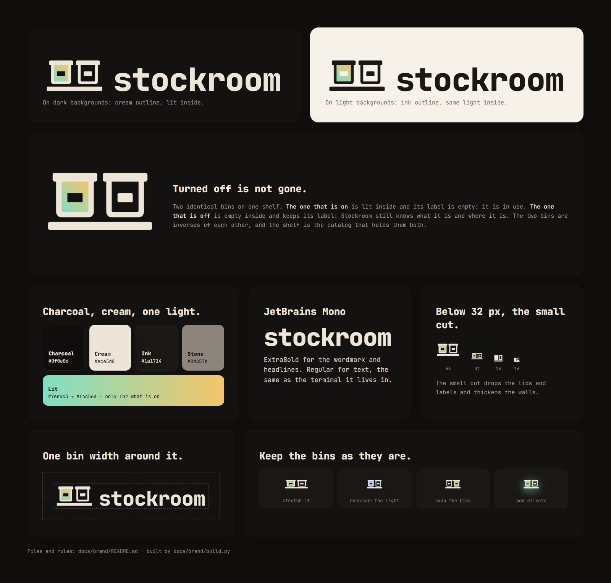

# Stockroom brand



## The idea

Two identical bins on one shelf. The one that is on is lit inside and its label is empty: it is in use. The one that
is off is empty inside and keeps its label: Stockroom still knows what it is and where it is. That is the product's
promise, turned off is not gone, in one picture.

## Files

| Use | Dark background | Light background | One colour |
|---|---|---|---|
| Logo (horizontal, the default) | `lockup-dark.svg` | `lockup-light.svg` | `lockup-white.svg`, `lockup-black.svg` |
| Stacked | `stacked-dark.svg` | `stacked-light.svg` | |
| Symbol, 32 px and up | `symbol-dark.svg` | `symbol-light.svg` | `symbol-white.svg`, `symbol-black.svg` |
| Symbol, 16 to 24 px | `symbol-small-dark.svg` | `symbol-small-light.svg` | |
| Wordmark | `wordmark-dark.svg` | `wordmark-light.svg` | |
| App icon, avatar | `app-icon.svg`, `app-icon.png` (512 px) | | |
| GitHub social preview | `social-preview.png` (1280 × 640) | | |

In a GitHub README, switch with the reader's theme:

```html
<picture>
  <source media="(prefers-color-scheme: dark)" srcset="docs/brand/lockup-dark.svg">
  
</picture>
```

## Colour

| Name | HEX | RGB | Use |
|---|---|---|---|
| Charcoal | `#0f0e0d` | 15 14 13 | Dark background |
| Cream | `#ece5d8` | 236 229 216 | Logo and text on dark |
| Ink | `#1a1714` | 26 23 20 | Logo and text on light |
| Stone | `#8d857b` | 141 133 123 | Secondary text (5.3:1 on charcoal) |
| Lit | `#7ee0c3` → `#f4c56a` | 126 224 195 → 244 197 106 | Only for what is on: the lit bin, the winning bar in a chart |

The lit gradient is the same on dark and light backgrounds: the bin's outline carries the contrast. The one-colour
versions fill the lit bin solid.

## Type

JetBrains Mono (SIL Open Font License): ExtraBold for the wordmark and headlines, Regular for text. The wordmark in
the files is drawn as outlines, so it never depends on the font being installed.

## Rules

- **Clear space:** one bin width on every side.
- **Minimum size:** the logo 120 px wide; the symbol 32 px. Below 32 px use the small cut.
- **Don't** stretch it, recolour the light, swap the bins, add shadows or glows, or type the wordmark in another font.

## Rebuild

```sh
python docs/brand/build.py JetBrainsMono-ExtraBold.ttf   # the SVGs (needs fontTools)
node docs/brand/render.mjs                               # the PNGs (needs Playwright)
```
